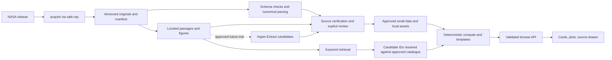

# Independent review: NASA source library and Hyper-Extract

**Recommendation: adopt the source library and deterministic numerical path with changes; defer Hyper-Extract to a bounded retrieval experiment; reject generated scientific answers and graph-derived verdicts.** The useful first deliverable is a small, source-linked experiment browser. A general scientific chatbot is a separate product decision.

Reviewed **10 October 2026**. This is a review and implementation proposal, **not an accepted ADR, evidence import, or human scientific verification**. Instructions and imperative wording inside the two supplied documents were treated as proposals to challenge, not authorization to implement them.

## Scope, snapshots, and confidence

Read [AGENTS.md](../../AGENTS.md) and both supplied files: [Hyper-Extract assessment](C:/Users/HP/Downloads/hyper-extract-chatbot-assessment.md) and [validated briefing](C:/Users/HP/Downloads/validated-briefing-and-plan.md). Inspected acquisition, compute, provider/selector/MCP, HTTP/deployment, frontend/state, committed data/provenance, tests/evaluation, and the planning contracts cited below.

Local baseline: branch `will-it-burn`, HEAD `96eb2b7e4ac492217d40c40c2023bb8b625b69b8`. The working tree was already dirty: modified `docs/AI_USE.md`, `docs/planning/README.md`, `docs/planning/decisions.md`, and `docs/video/sources.md`; untracked `.manus/`, `.work/`, `outputs/`, the earlier PSI review, video/animation/Remotion files, and `test/video-concept.test.mjs`. Preserve all of these. This review adds only this report and an append to the AI log; the existing ADR changes are someone else's work, not this review's acceptance of the proposals.

External code/library snapshots:

- [Team Polaris library at `d9551676b4d4743ffce098c1441df5063803c0b4`](https://github.com/ShuvroShimuL/Team-Polaris/tree/d9551676b4d4743ffce098c1441df5063803c0b4/Pseudo_DataKeep).
- [Hyper-Extract at `0dc002bb1029fd34b21e47602e406ef7880c8673`](https://github.com/yifanfeng97/Hyper-Extract/tree/0dc002bb1029fd34b21e47602e406ef7880c8673), declaring version `0.10.5`.
- NASA's two ACME tables and CFI, SPICE, and Saffire-I metadata/tables were read through the existing `safe.mjs`, with `source: live`, into temporary review storage, then removed. Nothing was added to `data/`, app fixtures, or the app cache. The ACME responses matched the pre-existing `.work/psi-review/` snapshots as decoded text. GitHub CSVs and upstream source code were inspected through the read-only GitHub connector. NASA web sources supplement those reads.

**Inspected** means a file, source response, or implementation was read. **Tested/reproduced** means an existing automated check or a specified calculation was actually run. **Unverified** means no execution, original-byte comparison, source-image check, or human review establishes the claim. Source similarity, a passing test, and an AI review do not establish scientific approval.

## Adopt / adopt with changes / reject

| Proposal | Decision | Reason and required change |
|---|---|---|
| Preserve originals with versioned manifests and provenance | **Adopt with changes** | Preserve NASA files independently of renamed distribution copies. Pin accession/release and Git revision, hash original bytes, record transformations and source restrictions. The inspected library has three CSVs and six PDFs, but no manifests or field-level provenance in its three folders. Hyper-Extract's current-copy archive is insufficient for historical versions. |
| Parse numerical tables deterministically | **Adopt** | This is essential under rules 1–3 and ADR-012. Add dataset-specific schemas and field locators around the existing CSV parser. Parsing alone does not approve an interpretation or create verdict eligibility. |
| Use Hyper-Extract for source retrieval | **Adopt with changes, deferred** | Evaluate retrieval-only `chunk_rag` against a local keyword/chunk baseline after locator and call-boundary decisions. Preserve a separate page/row-to-chunk map. An index is not evidence verification, and semantic queries still require an embedder. |
| Use Hyper-Extract for candidate relationships | **Adopt with changes, deferred** | Keep outputs in preparation storage, with source scopes and review state. Promote only independently source-supported assertions. Require measured benefit on relationship questions before accepting graph cost and complexity. |
| Render chatbot evidence cards, charts, and source figures | **Adopt with changes** | Resolve approved IDs into compute templates, chart data, and curated local assets. Values and figure captions open exact sources. Browse records, quoted context, measured observations, and illustrations need distinct labels. A cited generated answer remains prohibited. |
| Connect Hyper-Extract MCP `ask` directly to the UI, or use graph traversal to decide matches | **Reject** | `ask` returns model-written text. Graph similarity and connected paths cannot establish joint per-test conditions. Neither citations nor a new database relax ADR-004/012/013. |
| Start with a database, complete archive mirror, telemetry processing, or a Python service in the app | **Reject for the first slice** | Small CSVs and JSON are sufficient. No demonstrated need justifies changing the no-install runtime, deployment size, acquisition boundary, or offline contract. |

## The current contracts constrain the design

| Inspected implementation | Consequence for the proposal |
|---|---|
| [safe.mjs](../../src/acquire/safe.mjs), especially `keyFor` and `fetchSafe`; [ntrs.mjs](../../src/acquire/ntrs.mjs) | Public-data access is live → cache → fixture; `OFFLINE=1` skips networking. JSON/text responses are buffered and cached as JSON. MD5 identifies requests, not content integrity. This is neither an immutable byte archive nor a binary/ZIP pipeline. The name “safe” does not establish host/redirect allowlists, streaming limits, or archive safety. |
| [psi.mjs](../../src/acquire/psi.mjs:27) | Supports named experimental CSVs for PSI-25/69/99, not general release/file inventory. Its cache name is only accession-based; two tables or multiple releases of one accession would collide. New keys must include accession, version, and table identity; reject unexpected metadata versions. |
| [csv.mjs](../../src/compute/csv.mjs:4) | Supports quoted cells and embedded line breaks, trims cells, and makes blanks `null`. `tableFrom` collapses header whitespace and drops all-blank records, but loses original record ordinals and silently ignores cells beyond header width. It does not validate duplicate headers, schema identity, field semantics, or malformed quote termination. Keep original bytes and validate before object mapping. |
| [evidence.mjs](../../src/compute/evidence.mjs), [sets.mjs](../../src/compute/sets.mjs), [applicability.mjs](../../src/compute/applicability.mjs:89), [scenario.mjs](../../src/compute/scenario.mjs:346) | The research record shape is specifically 20 PMMA sheet tests. The cabin answer has PMMA, SIBAL, and Nomex sets; fabric includes four original BASS rows and excludes reused samples. Matching checks each test's conditions jointly, retaining unresolved/unrecorded requests and closest misses. The BASS station-pressure convention and oxygen/airflow restrictions are experiment-specific. New regimes cannot inherit them by sharing column names. |
| [saffire.mjs](../../src/compute/saffire.mjs), [flex.mjs](../../src/compute/flex.mjs), [response.mjs](../../src/compute/response.mjs), [findings.mjs](../../src/compute/findings.mjs) | Saffire here is **Saffire-II**, related evidence only. FLEX droplets supply response-card context, not solid-material verdicts. Ranked findings use the 20 acrylic rows and explicitly distinguish pairs from independent tests. NASA response steps retain their source's wording/order. A new catalogue must not alter these denominators or actions. |
| [provider.mjs](../../src/agents/provider.mjs:17), [evidence-selector.mjs](../../src/agents/evidence-selector.mjs:12), [mcp-server.mjs](../../src/agents/mcp-server.mjs) | Authenticated requests cross one boundary, refuse offline/missing keys, time out, and never cache. Selection is `{ids, abstain}`, ≤5 offered PMMA IDs, followed by validation and compute wording. The current selector is not a general experiment/view selector. MCP exposes deterministic tools with validated arguments, not unconstrained scientific writing. |
| [server.mjs](../../src/api/server.mjs), [api/index.mjs](../../api/index.mjs), [vercel.json](../../vercel.json) | Routes serialize compute and validate requests. Existing `/api/data`, `/api/search`, `/api/compare`, and `/api/brief` are PMMA contracts; `/api/ask` is the cabin contract. Add a separate browse contract instead of overloading these shapes. `data/**` is bundled for Vercel, so large originals/preparation outputs should remain outside it. |
| [web/app.js](../../web/app.js:388), [web/state.js](../../web/state.js), [web/library.js](../../web/library.js), [web/research/app.js](../../web/research/app.js) | The home page renders server evidence, local plots, and source-row dialogs; request state protects against stale replies. “My library” stores requests, not scientific answers. The research view assumes PMMA. Add bounded browse cards to the primary product only after updating feature/requirements contracts; preserve escaping, focus, request ordering, and both themes. |

The controlling planning documents are [architecture](architecture.md), [data model](data-model.md), [agentic design](agentic-design.md), [requirements](requirements.md), [features](features.md), [datasets](datasets.md), [vision/scope](vision-and-scope.md), [roadmap](roadmap.md), [offline demo](offline-demo.md), and [ADR log](decisions.md). FR-03/05/09/10 and NFR-01/02/03/05/09 remain binding. FR-12 source badges and FR-13 full provenance remain partial; the existing row dialog should not be described as a completed generic provenance system.

Some planning text lags code: architecture's deployment paragraph still describes no public API, while the hosted handler exists and ADR-014 remains **Proposed**; the dataset/roadmap prioritizes more BASS and Saffire IV–VI, not a broad gas/droplet chatbot. Working-tree ADR-015/016 address separate video authoring and request history, respectively. They authorize neither Hyper-Extract dependencies nor independent model credentials. These inconsistencies need reconciliation during an approved feature change, not silent reinterpretation in this review.

## Verified source findings

### ACME: rectangular CSV, mixed meanings

The [pinned combined CSV](https://github.com/ShuvroShimuL/Team-Polaris/blob/d9551676b4d4743ffce098c1441df5063803c0b4/Pseudo_DataKeep/ACME/ACME_Experimental_Table.csv) contains **333 nonempty records: 179 normal, 154 inverse**, all with **18 cells**. `Flame Type` is present, with case variations. There is one normal header and no inverse header. The first inverse record is **CSV record 181, including the header as record 1**, immediately after normal `21291 J3`.

Live NASA's [normal CSV](https://psi.nasa.gov/geode-py/ws/studies/PSI-159/download?file=PSI-159_Experimental%20table_CFI-G_Normal%20Flames.csv) has 18 columns; its [inverse CSV](https://psi.nasa.gov/geode-py/ws/studies/PSI-159/download?file=PSI-159_Experimental%20table_CFI-G_Inverse%20Flames.csv) has **20**. For inverse `21196 A1`, the combined file has:

| Combined column | Cell | Actual NASA inverse meaning |
|---|---|---|
| `Cool flame?` | `0.2981` | `Xf before test` |
| `XO2 before test` | `0.2981` | `Xf after test` |
| `XO2 after test` | `1.1` | `approx p (bar)` |
| `approx p (bar)` | `0.21` | `XO2` |
| `Xf` | `1.5` | `HC burnrate (mg/s)` |
| `mHC (mg/s)` | `5.59` | `O2 flow rate (mg/s)` |

**A row-width test alone passes this defective file.** Independent comparison found all 179 normal records and all 154 inverse records numerically equivalent to the live originals after trimming, matching whitespace-normalized IDs, allowing flame-type case differences, and projecting inverse columns 1–17 plus Comments. The combined file drops inverse **Kelvin temperature and Color**, and shortens numeric text such as trailing zeros. This demonstrates a transformation; it does not establish an approved transformation history or original-byte identity.

There are 333 distinct whitespace-normalized indexed IDs, not 333 proven independent experiments. NASA inverse has **861 entirely blank data records**, which must remain in the original but never enter test counts. Only **8 normal rows** populate `Cool flame?`; blanks and the inverse column's absence are unknown, not negative outcomes. Preserve oxygen-before/after and fuel-before/after separately; do not reinterpret endpoints as constant conditions. Preserve mixture labels such as `30% butane`.

The validated briefing's correction of the temperature warning holds: `27.1 + 273.15 = 300.25`. Recomputed all **151 numeric Celsius/Kelvin pairs** with no discrepancy above the earlier audit's 0.011 K rounding allowance; three inverse rows lack two numeric values. That allowance checks displayed-unit consistency only, **not applicability tolerance**. A1's `0` and A2's `35` seconds reproduce the actual source cells; zero is not missing. Peak burner temperature is not automatically flame temperature. The upstream [PSI-159 record](https://psi.nasa.gov/physci/repo/data/investigations/PSI-159) is the release authority; the attachment's v1/DOI mapping still needs a pinned manifest at import time.

### CFI droplets are distinct from ACME CFI-G gases

Live [PSI-39 metadata](https://psi.nasa.gov/geode-py/ws/repo/investigations/PSI-39) identifies **Cool Flames Investigation**, version **4**, DOI **10.60555/m6pj-a914**, CC0-1.0. NASA's objectives describe droplet size and liquid n-dodecane mixtures. Separately, [NASA's CFI presentation](https://www1.grc.nasa.gov/wp-content/uploads/CFI_SCR_May_2014_Dietrich_v1.pdf) describes low-gravity droplet combustion; [NASA's ACME paper, §3.6](https://ntrs.nasa.gov/api/citations/20210021781/downloads/JASMAC%20ACME%20paper%2020210921.pdf) describes quasi-steady flames on porous burners, contrasting droplet burning. This establishes different regimes, not interchangeable evidence.

The [GitHub CFI CSV](https://github.com/ShuvroShimuL/Team-Polaris/blob/d9551676b4d4743ffce098c1441df5063803c0b4/Pseudo_DataKeep/CFI/CFI_Experimental_Table.csv) is **decoded-text identical** to the live [NASA CFI table](https://psi.nasa.gov/geode-py/ws/studies/PSI-39/download?file=PSI-39_Experimental%20table_CFI.csv). Reproduced **87 nonempty records, 79 unique trimmed rows and FLEX IDs**, with eight repeated records: IDs `1285`–`1289` and `1295`–`1297`. CSV record pairs, including the header, are **24/81, 25/82, 26/83, 27/84, 28/85, 29/86, 30/87, 31/88**. These repetitions already exist in NASA's export; this review cannot attribute them to a teammate's concatenation or classify their experimental role.

The header has pressure, gas fractions, fiber, fuel, and identifiers, **no per-run cool-flame outcome**. A report-level phenomenon cannot fill that field for every row. Record 52 has `02:22:xx pm est`; retain partial time, unknown seconds, and the literal timezone label. IDs 1219–1222 list fractions `0.21, 0.76, 0`, totaling 0.97. Flag missing composition/rounding explanations for review; do not rebalance gases or infer the missing 0.03. These are source anomalies, not validated chemistry corrections.

### SPICE: repeated observations and unresolved time basis

Live [PSI-107 metadata](https://psi.nasa.gov/geode-py/ws/repo/investigations/PSI-107) identifies **Smoke Point In Co-flow Experiment**, version **4**, DOI **10.60555/9kbh-e962**, CC0-1.0. NASA describes gas-jet smoke-point work; this is unrelated to the navigation toolkit also called SPICE. The [GitHub CSV](https://github.com/ShuvroShimuL/Team-Polaris/blob/d9551676b4d4743ffce098c1441df5063803c0b4/Pseudo_DataKeep/SPICE/SPICE_Experimental_Table.csv) is decoded-text identical to the live [NASA table](https://psi.nasa.gov/geode-py/ws/studies/PSI-107/download?file=PSI-107_Experimental%20table_Spice.csv).

Reproduced **469 nonempty records, 435 distinct trimmed full rows, 34 excess exact repeats**. Neither number is an independent-test count. For example, records **32–36** share day `48` and `14:48:19` → `14:51:56`, while fuel rates vary from `31.2` to `180.6 sccm`; records **37–43** use dotted times for the same apparent group with additional settings. They could be settings/observations within a run, alternative annotations, or export duplication. That classification is unresolved.

The file mixes colon/dot times, `1744`, `1746`, blanks, `no ku`, and `Ku LOS`. Record **133** says `17:58:09` → `17:00:27`, while neighboring entries end after 18:00. The header provides `GMT date` integers without a year. Do not choose a year, change the end time, assume next-day rollover, infer a timestamp join, or calculate authoritative durations. Keep raw tokens, parse status, known components, and an unknown absolute timestamp. Formatting normalization is a documented transform, not resolution of chronology or run identity.

### Saffire-I confirms why promotion must be separate

Live [PSI-98 v4 metadata](https://psi.nasa.gov/geode-py/ws/repo/investigations/PSI-98) and its [469-character table](https://psi.nasa.gov/geode-py/ws/studies/PSI-98/download?file=PSI-98_Experimental%20table_SAFFIRE-1.csv) support two burn records plus two pre-test records. The CSV gives 420/70 s, 0.37 **cm**, and length/width 40.6/94 cm. NASA's [results presentation, Saffire-I description and Table I](https://ntrs.nasa.gov/api/citations/20170008805/downloads/20170008805.pdf) gives one panel, reuse of remaining fuel, 0.37 **mm**, width 40.6 cm, original length 94 cm and approximately 10 cm for the second burn. Oxygen is derived from CO₂ and the initial ISS reading. The 420 s burn ended at allotted airflow shutdown, so comparing durations is not a controlled directional effect. The presentation also differs between main-text and Table-I ignition power. Preserve both assertions and conflict status. PDF text was inspected; attempted page screenshots failed, so visual cell verification and the reviewed S1/S2 ↔ 1-1/1-2 join remain pending.

The live release lists 74 added, 1 modified, and 85 removed entries. These are change-list counts, not proven active inventory. Its workbook and readme were inventoried, not downloaded or parsed. The briefing's full archive sizes, asset joins, geometry interpretation, and telemetry promises have not all been independently reproduced here.

## What Hyper-Extract actually supplies

The pinned [provenance guide](https://github.com/yifanfeng97/Hyper-Extract/blob/0dc002bb1029fd34b21e47602e406ef7880c8673/docs/en/python/guides/provenance.md) documents document attribution, input-text SHA-256, rollback, and chunk ledgers. It explicitly marks graph node/edge → originating exact passage lineage as planned. **Document attribution is available; exact scientific-field provenance is not provided by this contract.** `chunk_rag` retrieves raw chunks, a different capability from proving the origin of an extracted graph assertion.

Additional code findings, all **inspection, not Hyper-Extract execution**:

- [readers.py](https://github.com/yifanfeng97/Hyper-Extract/blob/0dc002bb1029fd34b21e47602e406ef7880c8673/hyperextract/utils/readers.py) returns a plain string from direct text reading or MarkItDown conversion. It supplies no structured page/bounding-box/table-cell contract. Scanned PDFs require OCR beforehand; a nonempty result does not prove complete extraction. Encoding fallback may be lossy. Keep original bytes, encoding decisions, converted-text hashes, and explicit conversion failures.
- [CLI utils, `collect_directory_text_inputs`](https://github.com/yifanfeng97/Hyper-Extract/blob/0dc002bb1029fd34b21e47602e406ef7880c8673/hyperextract/cli/utils.py#L78) reads only immediate files and sorts by name. Pointing it at the three nested investigation folders does not recurse. The attachment's description of combining all files needs qualification: [CLI parse](https://github.com/yifanfeng97/Hyper-Extract/blob/0dc002bb1029fd34b21e47602e406ef7880c8673/hyperextract/cli/cli.py#L354) **feeds each file separately**, with its stem as source ID unless a single `--source` overrides every file. Use explicit versioned file IDs; avoid source-stem collisions and a shared source ID that may replace an earlier feed.
- [document.py](https://github.com/yifanfeng97/Hyper-Extract/blob/0dc002bb1029fd34b21e47602e406ef7880c8673/hyperextract/types/document.py#L38) defines `TextChunk` with `content` only; identical content is deduplicated by a truncated content hash. Source-scoped ledgers do not supply page/offsets in that object. Keep all source occurrences in our locator map; do not infer a unique source from one identical sentence.
- [document_store.py](https://github.com/yifanfeng97/Hyper-Extract/blob/0dc002bb1029fd34b21e47602e406ef7880c8673/hyperextract/utils/document_store.py) purges a source's previous archive before storing its current copy. It can preserve that copy's raw bytes, but is **not a versioned historical originals store**. Keep the canonical source library separately, and version source IDs.
- [MCP `search`/`ask`](https://github.com/yifanfeng97/Hyper-Extract/blob/0dc002bb1029fd34b21e47602e406ef7880c8673/hyperextract/mcp_server.py#L216) loads configured clients, calls semantic search, and in `ask` calls `ka.chat()` then returns generated content. Read-only search is eligible only as candidate retrieval. Do not register this server's generated-answer path as FlameScope scientific output.
- Graph extraction and optional graph community summarization use model calls ([base.py](https://github.com/yifanfeng97/Hyper-Extract/blob/0dc002bb1029fd34b21e47602e406ef7880c8673/hyperextract/types/base.py), [graph_rag.py](https://github.com/yifanfeng97/Hyper-Extract/blob/0dc002bb1029fd34b21e47602e406ef7880c8673/hyperextract/methods/rag/graph_rag.py)). Type-constrained output does not verify negation, experiment identity, units, temporal order, or source support. Disagreement must remain separate assertions, not a model's merged description.

The reader's suffix contract does not establish native flame-image/video measurement, OCR calibration, telemetry decoding, or synchronized camera analysis. “Spatial/temporal graph” names a representation. It is not evidence that those physical analyses exist.

## Retrieval comparison, dependencies, and offline behavior

| Approach over the same located passages | Ingest/build and query calls | Offline and provenance | Recommendation |
|---|---|---|---|
| Local keyword/chunk search with ID lookup and small aliases | Deterministic chunking/indexing and lexical scoring; no model/embedding calls | Works with bundled passages alone. Exact local locators and stable occurrence IDs remain available. May miss paraphrases. | **First baseline**; exact run/source IDs bypass ranking. |
| Hyper-Extract `chunk_rag` | No LLM fact extraction. Chunking itself is local; vector index construction embeds chunks, and semantic queries embed query text. Optional chat adds an LLM call and is prohibited as scientific output. | Cloud embeddings need network/credentials. An existing vector index alone cannot embed a new question. Fully offline semantic retrieval needs an approved, locally provisioned embedder and matching model/version/dimensions; otherwise fall back to keyword search. | **Deferred comparison**, retrieval only. |
| Graph/hypergraph extraction and retrieval | LLM calls extract relationships; merge/community options may add calls. Semantic indexes/query search also require embeddings. Some purely structured traversal can avoid query embeddings, but that does not validate its facts. | Saved graph browsing can be offline; new extraction or semantic search needs approved local services or network. Current graph provenance is document-level. | **Defer** until measured relationship benefit and exact source verification justify it. |

The author's [method-choice guide](https://github.com/yifanfeng97/Hyper-Extract/blob/0dc002bb1029fd34b21e47602e406ef7880c8673/docs/en/concepts/choosing-a-method.md) favors chunks for lookup/original wording and graphs for relationship questions. It explicitly is not a benchmark. No NASA retrieval accuracy, latency, cost, relationship precision, or offline-model quality has been tested in this review.

The pinned [pyproject.toml](https://github.com/yifanfeng97/Hyper-Extract/blob/0dc002bb1029fd34b21e47602e406ef7880c8673/pyproject.toml) requires **Python ≥3.11**, declares **Alpha** status, and lists `faiss-cpu`, `langchain`, `langchain-community`, `langchain-openai`, `structlog`, `ontomem`, `ontosight`, `python-dotenv`, `semhash`, `typer`, `rich`, and `tomli-w`. The ingest extra adds `markitdown[pdf,docx,pptx,xlsx]`; MCP, Anthropic, and Google integrations have separate extras. These bring transitive dependencies; a pinned top-level commit with lower-bound dependency ranges is not a reproducible lock. [LICENSE](https://github.com/yifanfeng97/Hyper-Extract/blob/0dc002bb1029fd34b21e47602e406ef7880c8673/LICENSE) contains Apache-2.0 despite GitHub metadata's generic “Other” detection. Dependency/platform compatibility and redistribution of the six source PDFs remain unverified.

[client.py](https://github.com/yifanfeng97/Hyper-Extract/blob/0dc002bb1029fd34b21e47602e406ef7880c8673/hyperextract/utils/client.py) constructs independent model/embedder clients from environment/configuration, including `~/.he/config.toml`; its OpenAI preset names `gpt-4o-mini` and `text-embedding-3-small`. These are inspected tool defaults, not recommended models or verified availability. The inspected reader/client/CLI/MCP paths do not enforce FlameScope's `OFFLINE` gate or route through `provider.mjs`. Our Node boundary tests do not police an external Python process. Connecting the tool as-is would bypass ADR-013 even when its output stays candidate-only.

Prefer an isolated, locked **preparation environment** if a trial is later approved. All public downloads must continue through acquisition. Authenticated LLM **and embedding** calls require a documented provider adapter before running anything: the current provider is OpenAI-key-specific and has no tested embedding workflow or multi-provider policy. A preparation exception cannot be inferred from ADR-015. Local inference also needs a deliberate boundary decision, offline network-denial tests, pinned weights, and a release-independent fallback. Do not place secrets in manifests, graph dumps, logs, browser bundles, or committed configuration. Storing public-source-derived vectors/candidates is different from caching authenticated provider responses; that artifact policy must be explicit.

A future comparison should freeze one corpus, locator map, aliases, questions, and expected source occurrences; compare keyword, semantic chunks, then graph retrieval on that corpus. Include exact run lookup, gas-versus-droplet context, negations, missing outcomes, approximation, source conflict, duplicate sentences across documents, and absent joint conditions. Score passage recall@5, verified relationship precision, locator correctness, abstention, calls, latency, artifact size, and reviewer time separately. Provisional promotion gates: zero incorrect numeric values/unsupported verdicts in rendered output; every displayed item resolves to an approved locator; graph retrieval must recover a predeclared relationship task the simpler baseline misses without losing baseline correctness. Numerical accuracy belongs to parser tests, not retrieval hit rates. Thresholds and benefit targets need team approval before a real trial.

## Minimal storage and schema

Use existing folders and compact JSON/CSV. Logical originals → preparation → approved evidence does not require bronze/silver/gold infrastructure, a graph database, Parquet, or a repository rename.

```text
external-source-library/<accession>/<version>/
  manifest.json
  originals/                       immutable source bytes, including blank padding
  transforms/                      explicit derivatives with input hashes
.work/source-preparation/<release>/
  passages.jsonl + locator-map.json
  candidates/ + review-decisions.json
data/investigations/<accession>/<version>/
  reviewed small CSVs + manifest.json + provenance.json
  approved-passages.json + approved-links.json   only when reviewed
web/assets/sources/<release>/       selected offline figure previews only
```

Large originals/media live outside app deployments; manifests can list absent assets. Existing `data/bass-*`, APIs, fixtures, and compute policies retain their shapes. New original bytes are never rewritten to fit a loader. Keep original-byte SHA-256, converted-text digest, and derived-export digest separate. Git blob SHAs identify the inspected copy; they are not our future SHA-256 integrity check or proof of NASA origin.

| Entity | Minimal fields and invariants |
|---|---|
| Release | `releaseId`, accession, actual version, DOI/report ID, source URL, source restrictions/licence, scientific regime, imported scope, record-count definition, capabilities, `verdictEligible: false`. Scope must distinguish indexed records, inferred runs, and independent samples. |
| Source file | `fileId`, release, exact original filename, stored filename, canonical download URL, distribution-copy Git commit/path, fetch date, original encoding/bytes/size/SHA-256, `original|transformed|unknown`, parent file IDs, transformation tool/version, schema ID, acquisition source. Unknown origin stays unknown. |
| Source record / run | `recordId` based on file identity and original CSV record ordinal; original ID plus separate normalized ID; table/schema/configuration/regime; `runId` nullable; duplicate/sequence/physical-sample group nullable. Do not manufacture a run ID from a SPICE timestamp or deduplicate away source occurrences. |
| Observation / provenance assertion | Field name, raw text, nullable typed value, unit/form/qualifier, condition/outcome/context role, measurement method/type, source references, transformation, verification state and reviewer/date. A source locator includes file, record, column, and header identity, or page/table/row/figure. Maintain `missing[]` and missing reason without converting unknown into not-applicable. |
| Passage | Exact source text, file ID/hash, physical PDF page and printed page when known, section/table/figure, locator/optional bounding box, conversion version, text offsets, all occurrence IDs, review state. Model descriptions are stored separately as candidates. Quotes need literal wording, attribution, and appropriate excerpt limits. |
| Relationship | Typed subject/object IDs, candidate/approved/rejected/conflicted state, exact supporting source refs and assertion scope. Investigation context cannot automatically become every run's observation. Bind all conditions through one documented run/observation group. |
| Asset / derived chart | Source-file or figure ID, record/passage links, path/format/licence, `listed|downloaded|parsed|verified` states, original checksum when acquired, curated local preview and alt/caption text. A crop references source page/figure and transform; a plot references verified observations, units, grouping rule, and compute transform version. |

For a numeric field, retain both syntax and semantics: `{raw, value, unit, form, qualifier, role, measurementType, sourceRefs, verificationStatus}`. A before/after pair, scalar, ramp, range, approximate value, and interval have different forms. A source zero stays zero; an invalid token becomes `value: null` with parse error and missing status. Do not use `parseFloat` on `~21.5` or arbitrary text and silently declare a measurement. No interpolation, guessed conversion, implicit cool-flame outcome, or tolerance is authorized by this schema.

Separate **acquisition state** (`live/cache/fixture/committed` as appropriate to delivery) from **verification state** (`pending/approved/conflicted`). A once-live snapshot later shipped in `data/` is committed data; its original acquisition can be recorded historically without labelling its runtime values live. A file being listed/downloaded/parsed never implies its fields are verified.

## Source-to-frontend architecture



Retrieval chooses candidates; a resolver admits only approved IDs from the pinned release. The optional model may select offered approved IDs or abstain through the provider, and deterministic compute renders the result. An expanded intent/view schema requires a documented extension; the existing PMMA selector does not already authorize it. Treat questions **and document text** as untrusted data, and validate IDs, URLs, paths and all tool outputs. A source document must never become executable instructions.

Cabin questions continue through `/api/ask` and the current applicability functions. General experiment lookup requires an explicit browse action/contract. A gas/droplet graph path cannot supply a solid-material verdict, oxygen from one run cannot join pressure from another, and a cited explanation cannot conceal unsupported conditions. Catalogue entries remain `verdictEligible: false` until a separately reviewed regime-specific policy exists.

The frontend receives whitelisted view data, no graph-generated prose or arbitrary HTML. Use approved quotations and compute templates for scientific wording. Distinguish source figures from derived charts and labelled illustrations. Charts show only verified observations with units, missing gaps, sample/group scope and descriptive caveats; they do not interpolate unknown measurements or rank regimes by safety. Every point/card opens its source record. Curated previews are same-origin local assets under the existing CSP; original NASA links are ordinary external links. Show an explicit unavailable-preview state offline instead of fetching remote media or substituting imagined footage. Validate source-link schemes/hosts and local asset IDs server-side, in addition to text escaping.

## Blockers, unresolved assumptions, and proposed ADR topics

**Blockers before imports or a trial:** no canonical library manifests; ACME's misleading shared header; no per-field approval ledger/locator adapter; no documented CFI/SPICE run/duplicate/time semantics; no approved Hyper-Extract provider/embedding boundary; no measured benefit beyond simpler retrieval. These block scientific promotion, not the ability to inspect sources.

**Unresolved assumptions:** the six PDFs are the exact NASA originals, their redistribution/preview rights, complete page/table/figure extraction, OCR quality, meaning of TFP/Tad/Zst and temperature channels, approximate-pressure measurement role, independent sample/run groups, active inventories across release changes, and full telemetry/channel definitions. Only PDF names/sizes were inventoried in GitHub; their bytes were not acquired/hashed or all their contents reviewed. NASA CFI metadata corroborates droplet identity independently of the uninspected CFI final-report copy. Hyper-Extract was not installed/executed, and transitive code, Windows wheel compatibility, resource costs, embedding quality and graph precision were not tested. Saffire's reviewed cross-source joins and human conflict resolution remain pending.

Draft ADR **topics only**, with no numbers/status assigned and no edits to accepted decisions:

1. **Versioned source preparation and promotion.** Separate immutable originals, derived candidates and approved evidence; define hashes, locators, reviews, duplicate occurrences, release update/invalidation behavior, and offline exports. A changed source must invalidate or re-review dependent assertions/assets, not silently overwrite their evidence.
2. **Binary acquisition extension**, only if downloading/preserving PDFs or preview assets through project tooling. Extend the central acquisition boundary with byte integrity, bounded/streamed downloads, timeout/host/redirect controls, atomic completion and restriction handling; add archive path/expanded-size controls only if archive ingestion is actually approved. Existing `fetchText` cannot preserve arbitrary binary originals. A table-only slice can postpone this ADR.
3. **Isolated Hyper-Extract preparation and model/embedding adapter**, only before a trial. Pin dependencies and models, define candidate-only outputs, authenticated-call ownership, offline refusal/fallback, public derived-artifact persistence, secrets, and forbidden generated-answer paths. Keep Node dependency-free. Extend ADR-013 explicitly rather than configuring a second credential path.

An expanded chatbot intent contract or a new verdict regime additionally needs its own product/applicability decision and tests. It cannot be smuggled into these storage/toolchain ADRs. During approved implementation update [requirements](requirements.md), [features and change log](features.md), [data model](data-model.md), [datasets](datasets.md), architecture and fixture documentation where behavior changes. This review deliberately changes none of those accepted contracts.

## One small implementation slice — proposed, not performed

**ACME v1, source-linked single-run lookup, browse-only.** Preserve the two original NASA CSVs, a reviewed release manifest/provenance and separate schema mappings. Add one pure loader and a validated read-only run lookup endpoint, with IDs namespaced by accession/version/configuration. In the primary workspace add one modest experiment-context card that opens a run's recorded values, limitations and source drawer. No general conversational router, filtering system, graph index, PDF conversion, source-figure pipeline, telemetry, or new verdict set is needed. This slice tests the library's most concrete schema hazard and avoids making Saffire geometry reconciliation a prerequisite for demonstrating the ingestion path.

This differs from the validated briefing's Saffire-I-first recommendation. Saffire's source conflicts and shared panel make it valuable context, but ACME's two tiny machine-readable schemas provide a narrower deterministic acceptance target for this library review. Both remain outside cabin verdicts. If the team keeps Saffire first, retain its source-conflict/sample-reuse gates rather than copying this ACME contract.

Acceptance tests for that future slice:

1. **Schema and lineage:** original file hashes/header identities/version verified; separate 18/20-column schemas; 179/154 nonempty indexed records; 861 inverse blank records excluded from counts but preserved in the original; original ordinals survive filtering. Reject wrong schemas and normalized-ID collisions. A combined normal-header/inverse-values adversarial file is rejected even though every row has 18 cells.
2. **Published values:** independently review and reproduce inverse A1/A2's `0`/`35 s`, `1.10 bar`/`0.21 XO2`, and `27.1 °C`/`300.25 K` with file/record/column locators. Keep all original inverse fields, including Color. Blanks become `null` plus `missing[]`; invalid numeric tokens are quarantined; no implicit cool-flame outcome. Header text or model output never supplies numeric meaning.
3. **Offline delivery:** with `OFFLINE=1`, absent cache and unavailable provider, load the release from explicit fixtures/committed sources with correct source labels. Corrupt cache falls back; missing fixture gives a visible unavailable state. Changed release/version must fail the pinned manifest check. Assert zero real provider/embedding transports.
4. **Applicability regression:** new records never enter `SETS`, mission badges, BASS ranking or `/api/compare`'s PMMA shape. Preserve ISS acrylic, Moon/34% O₂, 1 mm/16.8% O₂/21 cm/s, SIBAL/21% O₂/53 cm/s, unsupported material, and unresolved-number behavior. Loading browse evidence cannot change their matched IDs or verdicts.
5. **API/UI evidence:** reject unknown IDs and oversized/malformed requests; show recorded field form/units, separate committed/acquisition and verification states, and `verdictEligible: false`. Every displayed value opens its exact source. Test escaped malicious labels, blocked arbitrary links/assets, keyboard drawer dismissal/focus return, loading/error/empty states, stale replies, and unchanged local CSP. Do not show a Burned/No-flame-held stamp for a catalogue record.
6. **Release checks:** existing `node --test` stays green, existing eval stays 20/20, offline HTTP/page smoke passes, and relevant feature/requirements/data/fixture docs plus AI log are updated. Human source review remains a separate recorded gate, not replaced by those automated checks.

## Five decisions required before implementation

1. **Which source is canonical, and who approves it?** Recommend NASA accession/version snapshots as authority, GitHub as a distribution copy, transformed ACME labelled explicitly, and a named human reviewer for field mappings/provenance. Confirm which originals/versions may be stored and redistributed.
2. **What is the first product promise?** Recommend the bounded ACME browse slice above, with no new verdict regime or free-form scientific RAG answer. Choose whether Saffire instead goes first, and agree on the primary-workspace entry point and exact API/selection scope.
3. **How are source ambiguities represented and resolved?** Approve field forms, unknown measurement roles, duplicate occurrences versus runs, physical-sample grouping, timestamp uncertainty and conflict handling. Assign CFI/SPICE dictionaries and Saffire joins to review; unresolved values remain missing/conflicted rather than repaired by a model.
4. **Is semantic/graph retrieval justified, and under which call boundary?** Recommend local keyword/chunks first. Set the same-corpus evaluation and benefit gates, then decide whether to approve a locked Python trial with provider/embedding adapter, pinned model policy and offline fallback. No tool credentials or trial calls precede that decision.
5. **What fits in the offline release and deployment?** Set small-table/passage/preview scope and byte budget; decide who curates figures and approves binary acquisition. Keep large archives/preparation outside `data/**`, use local previews with exact locators and captions, and accept unavailable assets explicitly.

## Checks actually run and limits

- **127/127 existing tests passed** on Node **v24.13.1**, with `OFFLINE=1` and the shell `OPENAI_API_KEY` removed. The restricted first run failed on loopback `EACCES`; the authorized loopback-enabled retry passed. Provider tests replace transport and use fake keys. No real model or embedding call was made.
- **20/20 existing offline retrieval/abstention evaluation cases passed.** This evaluates the current PMMA deterministic path, not Hyper-Extract or the proposed source library.
- **Offline HTTP smoke passed:** `/` and `/research/` returned 200 with the existing CSP; `/api/data` had 20 PMMA records and AI unavailable; ISS acrylic returned Burned; Moon/34% oxygen and both joint-condition audit questions returned No data; `ai:true` brief returned the deterministic fallback with **zero provider transport calls**. The temporary server was closed. This was HTTP/API validation, not a new visual-browser or usability study.
- **Review calculations reproduced:** live ACME schemas/counts/blank padding/unit consistency; combined-file projections; live-to-GitHub decoded-text equality for CFI/SPICE; repeated-record counts and the cited timestamp/field anomalies. The calculations ran as review tooling, not new application tests or approved scientific imports.

No package installation, credential configuration, real model/embedding call, evidence import, implementation, accepted ADR change, commit or push was performed. Human scientific verification and the five decisions above remain pending.
